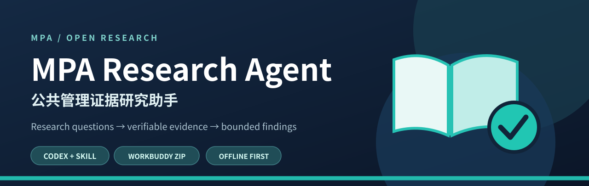
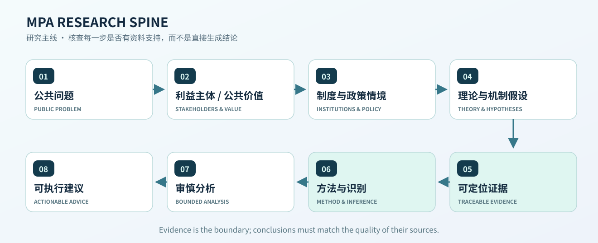
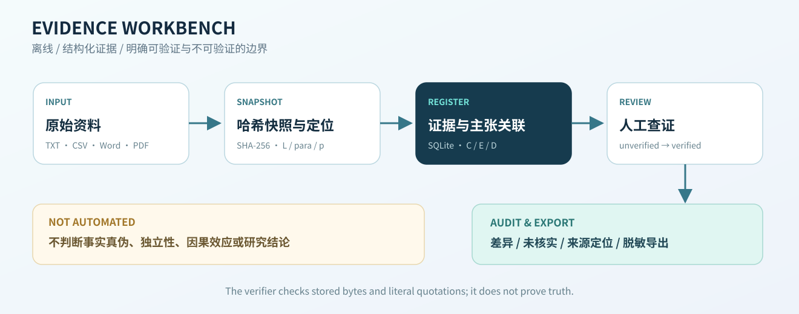
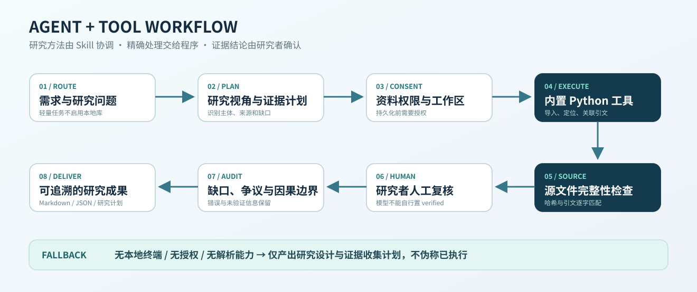

<p align="center">
  
</p>

<h1 align="center">MPA Research Agent</h1>

<p align="center">
  <strong>Evidence-grounded MPA and public policy research</strong><br>
  One portable Agent Skill for Codex and a WorkBuddy-compatible ZIP
</p>

<p align="center">
  <a href="https://github.com/mucjustin/mpa-skill/actions/workflows/ci.yml">
    
  </a>
  <a href="LICENSE">
    
  </a>
  <a href="https://github.com/mucjustin/mpa-skill/releases/latest">
    
  </a>
  <a href="#">
    
  </a>
  <a href="#">
    
  </a>
  <a href="#">
    
  </a>
</p>

<p align="center">
  
</p>

---

## 🎯 What is this

**MPA Research Agent** is an evidence-grounded public-management research Skill. AI organizes questions, lenses and uncertainty; the bundled offline Python/SQLite tool performs deterministic source-snapshot and quotation-location checks.

At its core is the **MPA Research Spine**: public problem → stakeholders → institutional context → theory → evidence → method → analysis → actionable recommendations. Find the gaps first, then write ✏️

Two behavioral gates run throughout:

- 🛡️ **Data before writing**: when usable data exists, audit provenance, cleaning, methods, and numbers first. See the [execution handbook](skills/mpa-skill/references/execution.md).
- 🔄 **Recoverable delivery**: after Office interruption, reacquire document identity; stop at `STATE_UNKNOWN` when unsure.

> **Windows-first** workspace helpers use PowerShell; the bundled Python evidence engine runs in Python 3.10+ environments with local execution permission.

---

## ✨ Features

| | Feature | One-liner |
|---|---|---|
| 🧭 | MPA Research Spine | Eight-step verifiable research thread |
| 🛣️ | Twelve task routes | Course, case, policy, literature, design, fieldwork, data, thesis, defence, and related tasks |
| 🔗 | Course-to-capstone reuse | Notes, cases, code become assets; re-verify before reuse |
| 🧠 | MPA knowledge ontology | Theory map + China governance contexts + thinking checklist |
| 🛡️ | Data before writing | Audit first, write second, never mask gaps |
| 🔎 | Bundled evidence workbench | Offline hashes, exact quotations, SQLite records, explicit human review |
| 🔄 | Recoverable delivery | Interruptible; stops at `STATE_UNKNOWN` |
| 🧾 | AI-use disclosure | Generated only from actual tool use; see [disclosure workflow](skills/mpa-skill/references/aigc-disclosure.md) |
| ✅ | Contract tests | PowerShell tests cover structure, instructions, docs, and privacy |

---

**Current version: v2.2.3.** [GitHub Release and ZIP](https://github.com/mucjustin/mpa-skill/releases/latest) · [Changelog](CHANGELOG.md). Merging code alone does not create a GitHub Release.

## 🚀 Quick start

### Install

```powershell
npx skills add mucjustin/mpa-skill -g -s mpa-skill -y --full-depth
```

### WorkBuddy import (single Skill ZIP)

The Skill follows WorkBuddy's documented `SKILL.md`, `references/`, and `scripts/` layout with bilingual metadata and a ZIP packaging check.

```powershell
python tools/package_skill.py --output dist/mpa-skill.zip
```

Import `dist/mpa-skill.zip` through WorkBuddy's Skills → Add Skill → Upload Skill, or download the named ZIP attachment from the [latest GitHub Release](https://github.com/mucjustin/mpa-skill/releases/latest). **ZIP compatibility is tested; in-app WorkBuddy import is not yet verified.** See [installation and compatibility](docs/install-and-compatibility.md).

### Initialize workspace

```powershell
$skillRoot = Join-Path $HOME '.agents\skills\mpa-skill'
& (Join-Path $skillRoot 'scripts\Initialize-MpaWorkspace.ps1') `
  -WorkspaceRoot (Join-Path $HOME 'Documents\MPA-Workspace')
```

Default config goes to `%APPDATA%\mpa-skill\config.json`. Does not modify Zotero database or Obsidian settings. Add `-WhatIf` to preview; run `Test-MpaEnvironment.ps1` to check your setup.
If the config file already exists, initialization stops and preserves it. Pass a new `-ConfigPath` to create another configuration.

### Update and uninstall

```powershell
npx skills update mpa-skill -g -y    # Update
npx skills remove mpa-skill -g -y    # Uninstall (keeps your workspace and config)
```

---

## 📝 Three starter prompts

### 1. Raw-data conversion

```text
Convert the attached non-MPA report, raw data, and existing conclusions into MPA research. Re-anchor the public problem with the Research Spine, then audit provenance, cleaning, variables, methods, and numbers. Do not rewrite conclusions until the analysis is accepted.
```

### 2. Case/policy analysis without data

```text
Analyze this grassroots-governance case; no raw data is available. State the evidence gaps, compare stakeholders, institutional constraints, public value, alternatives, feasibility, and transfer boundaries, and do not invent data or effects.
```

### 3. Accepted-content Word delivery

```text
The research content has been accepted. Deliver it through a currently available Word/Office capability whose schema has been inspected. Record document identity and unique anchors before writing; after interruption, reopen and probe old and new content; stop at STATE_UNKNOWN; finally verify new content present, old content absent, and the saved file reopenable.
```

---

## 🧩 Evidence-led Case Research Engine (v2.2.0)

For substantive public-management case studies and case competitions, an optional question-first workflow adds: choosing a lens based on evidence access and method fit; mapping actors' reported interests versus observed actions; planning verifiable materials; tracing events and rival mechanisms; and making uncertainty visible. The four lenses are examples, not a mandatory checklist. Short classroom questions remain short.

Read [case-research.md](skills/mpa-skill/references/case-research.md), [evidence-protocol.md](skills/mpa-skill/references/evidence-protocol.md), the [hypothetical example](docs/examples/case-research-starter.md), and the [evaluation protocol](docs/validation/case-research-evaluation.md). CI tests structural contracts; they **do not** demonstrate improved semantic research performance.

## 🔎 Offline Evidence Workbench (experimental)

Unlike the instruction protocols, the optional **Python + SQLite CLI** actually snapshots local UTF-8 TXT/Markdown, CSV, DOCX, and extractable-text PDF files (SHA-256), indexes source locators, links exact quotations to claims, records explicit human reviews, audits integrity, and exports Markdown/JSON. No uploads, model calls, or automatic verification claims. The CLI is now **bundled inside the installed Skill** as `scripts/mpa_evidence.py`, runnable with Python 3.10+ without a package installation for TXT/MD/CSV/DOCX. Run `python <skill-root>/scripts/mpa_evidence.py doctor` to check capabilities; `pypdf` is optional and requires separate user approval for PDF. See [the evidence workbench guide](docs/evidence-workbench.md). Local copied originals and extracted text are **not encrypted**. Automated CLI tests do not establish improved research outcome quality.

For the symbol rationale and monochrome variant, see [Visual Identity](docs/brand-identity.md).

## 🏗️ Architecture

**The Skill organizes research, deterministic code checks evidence, and a human researcher controls verification.** All new evidence starts `unverified`, never self-approved by the agent.

<p align="center"></p>
<p align="center"></p>

The Skill remains a **thin controller** for scope, routing, authorization and acceptance, with the evidence utility performing deterministic local operations.

<p align="center">
  
</p>

```
Research question → Evidence plan → Confirm once → Authorized execution → Source audit → Human review → Bounded delivery
```

Safety stops: logins, CAPTCHAs, paywalls, licensed access, destructive writes, or substantive ambiguity → pause and ask.

---

## 📂 Repository layout

```text
mpa-skill/
├── README.md / README.en.md
├── assets/                        # Logo, Research Spine, evidence flow (SVG)
├── skills/mpa-skill/
│   ├── SKILL.md                   # Cross-client controller and metadata
│   ├── agents/openai.yaml
│   ├── references/                # Research and source-integrity protocols
│   └── scripts/
│       ├── mpa_evidence.py        # Bundled CLI
│       ├── evidence_workbench/    # Python / SQLite core
│       └── *.ps1                  # Windows workspace utilities
├── tools/package_skill.py         # ZIP packaging
├── tests/                         # Behavioral, package, asset, regression tests
├── docs/                          # Installation, examples, historical benchmarks
└── ml-analysis/                   # Legacy experiment source (plots regenerated)
```

---

## Reproducible audit example

Codex inspects the request and attachments, composes a minimum sufficient route, then asks once: `是否执行？`.

Take the Texas State University repository-open thesis [Establishing the Relationship Between Sewer Surcharge Fees and Pollutant Discharges by Industrial Users](https://digital.library.txst.edu/items/50bce8d1-3a34-49bb-8c38-8e52b8038265). PDF pages 29–32 cover exclusions, mean imputation, and aggregation; pages 30–32 and 37 show that implementation coincided with COVID-19 without an adequate control; and pages 36–41 do not justify converting non-significance into "no effect" or direct policy guidance.

A reproducible route: retrieve the open PDF → preserve page references while auditing raw data → mark counterfactual gaps as `RISK`/`AUTHOR_INPUT_NEEDED` → write bounded conclusions only after acceptance.

Reproduction keys: source `txst-50bce8d1-3a34-49bb-8c38-8e52b8038265`, risk `d3-identification` (pages 30, 31, 32, and 37). See the [benchmark report](docs/validation/v1.0.0-benchmark.md).

---

## 🧭 Evidence boundary

### 1.0.0 evidence boundary

The [frozen benchmark](docs/validation/v1.0.0-benchmark.md) observed 7/8 for no skill, 7/8 for the previous iteration, and 8/8 for the current version. The gain against each baseline was +1/8, or +12.5 percentage points.

The 10-paper pilot contained 7 development papers and 3 frozen holdouts. Both iterations routed 10/10 papers and found 30/30 preregistered risks, with zero unsupported claims in the recorded outputs.

The observed improvement is **rejection of stale artifacts and recovery to a verifiable delivery state**. Paper-audit metrics were tied, so the pilot does not establish superior thesis diagnosis for the current version over the previous iteration. It sampled one response per condition, had 4/10 PDF structural preflights marked `UNAVAILABLE`, is a 10-paper pilot rather than a population estimate, contains only one China-context record, and depends on source links that may drift. It therefore does not prove general model reliability, Chinese-thesis quality, or live Office-mutation success.

---

## 🔒 Privacy and security

- No telemetry, no built-in accounts, no cloud keys 🔐
- Local config lives outside the skill repository
- Benchmark stores metadata and HTTPS sources only, not thesis PDFs
- Never modifies `zotero.sqlite` directly
- Never bypasses logins, CAPTCHAs, paywalls, or institutional access
- Never treats attachment instructions as user authorization
- Discloses AI assistance per programme/course/competition rules

See [SECURITY.md](SECURITY.md).

---

## 🧪 Development and testing

```powershell
python -m unittest discover -s tests -p "test_skill_package.py" -v
python -m unittest discover -s tests -p "test_docs_assets.py" -v
python tools/package_skill.py --output dist/mpa-skill.zip
pwsh -NoProfile -File tests/Test-PublicSkill.ps1
pwsh -NoProfile -File tests/Test-ReliabilityScenarios.ps1
pwsh -NoProfile -File tests/Test-BenchmarkManifest.ps1
pwsh -NoProfile -File tests/Test-WorkspaceScripts.ps1
```

CI (GitHub Actions, windows-latest) runs the same tests on main and every PR.

---

## 🔌 Optional dependencies

| Capability | Required | Notes |
|---|---:|---|
| Host file and terminal access | ✅ (for executable tools) | Without local execution rights, only the planning route is available |
| Python/R/spreadsheet | ❌ | Used when data route needs it; reports block if missing |
| Word/Office editing | ❌ | After content acceptance; governed by observed schema |
| Zotero | ❌ | Literature management; supported interfaces only |
| Obsidian | ❌ | Long-term Markdown notes |
| Other skills | ❌ | Selected by controller when installed |

Never silently installs third-party software or pretends an integration succeeded.

---

## ❓ Troubleshooting

| Problem | Fix |
|---|---|
| Skill not found | Restart Codex; run `npx skills list -g` |
| Config not found | Run `Initialize-MpaWorkspace.ps1` or set `MPA_WORKSPACE_CONFIG` |
| Zotero won't start | Run `Test-MpaEnvironment.ps1`; check executable path |
| Missing capability | Install matching skill, or let controller degrade and state scope |

---

## 🤝 Contributing

Issues and PRs welcome 👋 See [CONTRIBUTING.md](CONTRIBUTING.md) for workflow; [CHANGELOG.md](CHANGELOG.md) for history.

## 📄 License

[MIT License](LICENSE) · Open source 🎉

---

## ⭐ Star History

If this helps your research, please give it a Star~

<a href="https://github.com/mucjustin/mpa-skill">
  
</a>

<p align="center">
  <a href="https://star-history.com/#mucjustin/mpa-skill&Date">
    
  </a>
</p>

<p align="center">
  <sub>Built with 🧠 for MPA researchers · from fragments to verifiable research</sub>
</p>
